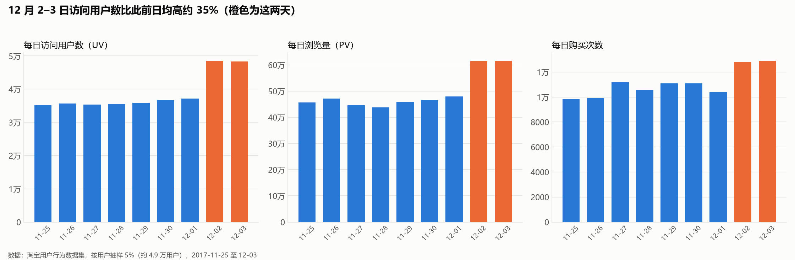
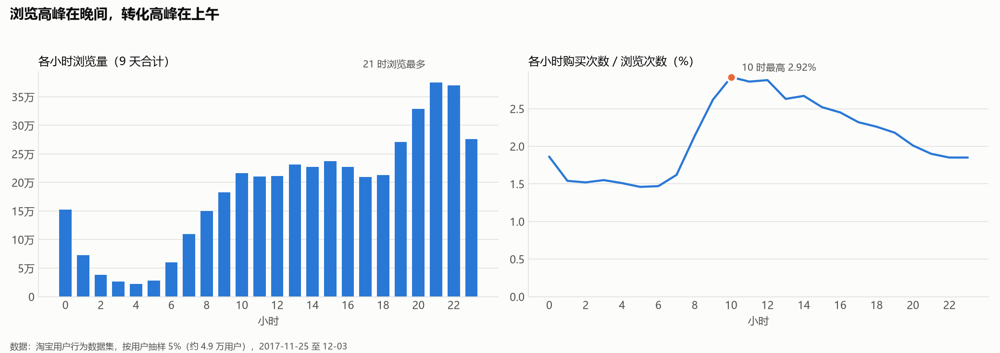
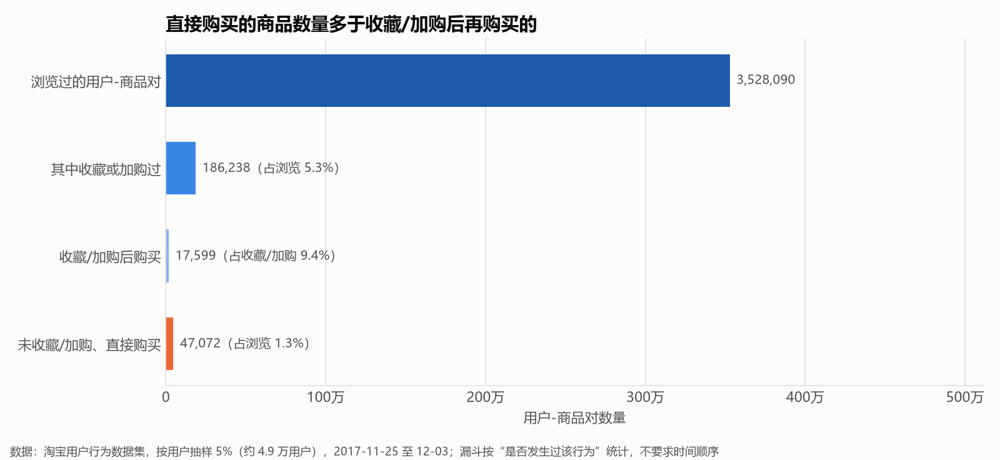
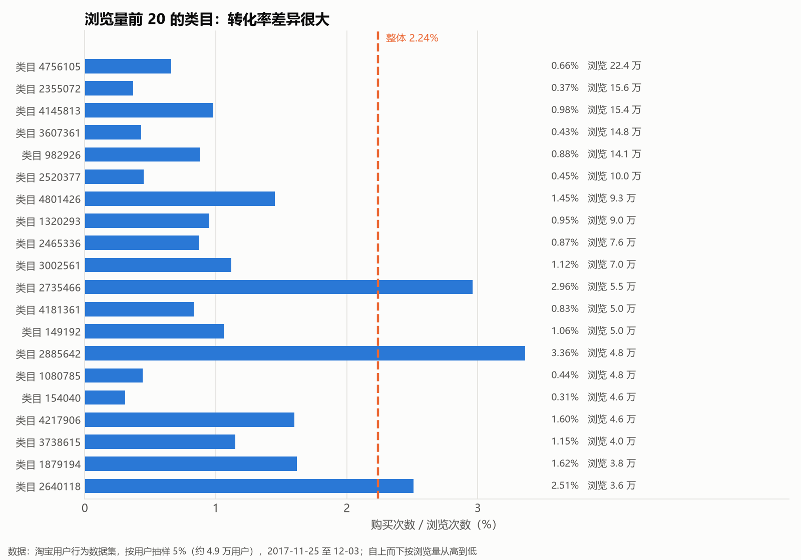
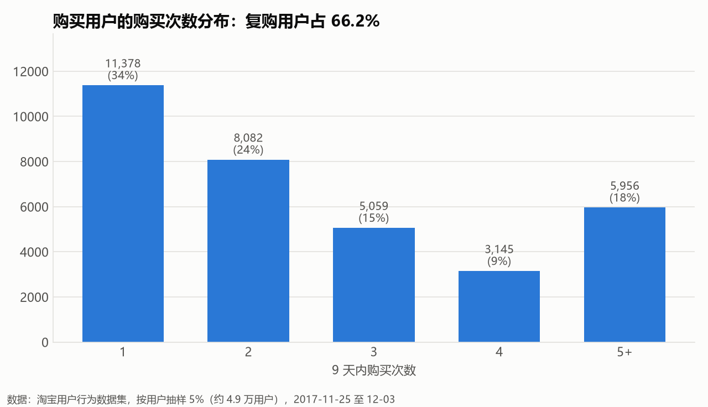
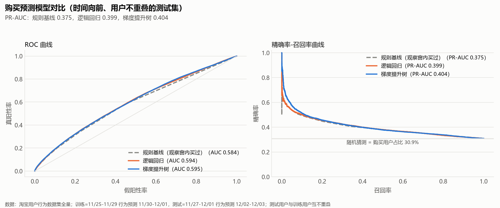
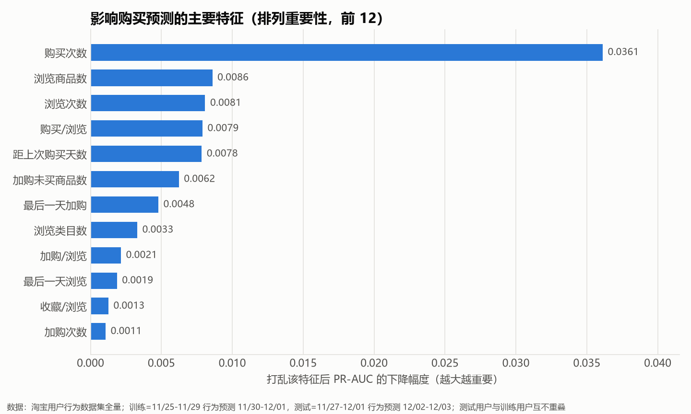
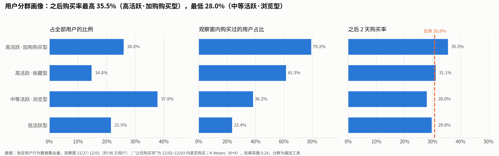

# 淘宝用户行为分析：MySQL + PySpark + scikit-learn

基于阿里天池公开的淘宝用户行为数据（约 1 亿条记录，9 天），完成一套从数据清洗、SQL 业务分析、全量特征工程到购买预测与用户分群的流程。重点不是追求模型分数，而是把每一步的口径、对照和局限讲清楚。

## 项目内容

- 用 MySQL 完成清洗、导入和 6 组业务分析（指标、时间趋势、转化漏斗、类目、加购流失、复购）。
- 用 PySpark 在全量 1 亿行上构建用户级特征，并按时间切分生成训练/测试快照。
- 用 scikit-learn 做购买预测（含规则基线对照）和 K-Means 用户分群。
- 所有 SQL 分别在 MySQL 和 DuckDB（5% 样本）上执行，结果逐项一致；Spark 特征在 5% 样本上与 DuckDB 独立重算的结果逐用户一致。

## 数据

- 来源：阿里天池 *User Behavior Data from Taobao for Recommendation*。
- 规模：100,150,807 行；字段为用户 ID、商品 ID、类目 ID、行为类型、时间戳；行为类型为 pv（浏览）、fav（收藏）、cart（加购）、buy（购买）。
- 时间：2017-11-25 至 2017-12-03，共 9 天（按北京时间）。其中约 5.6 万行（约 0.06%）时间戳落在该范围之外，清洗时剔除。
- 没有价格、用户画像和商品属性，因此分析只能围绕行为本身展开。
- 数据说明为随机抽取的用户，但观察窗内有购买行为的用户占比约 48–49%，明显偏高，结论能否外推到整个平台需要谨慎。

## 技术路线

| 步骤 | 工具 | 说明 |
|---|---|---|
| 抽样 | awk / Python | 按用户抽取 5%（每 20 个用户取 1 个），保证每个用户的行为轨迹完整 |
| 导入、清洗、业务分析 | MySQL 9.7 | `sql/00`–`09`，编号顺序执行 |
| 对照验证 | DuckDB | 同一批 SQL 在 DuckDB 上重算，结果一致 |
| 特征工程 | PySpark 4.2 | 全量数据，输出约 195 万行用户级特征 |
| 建模与分群 | scikit-learn | 逻辑回归、梯度提升树、K-Means |
| 可视化 | pandas / matplotlib | 图直接由 SQL 结果生成 |

## 一、业务分析（5% 用户样本：49,396 名用户，约 497 万条记录）

> 样本中 68% 的用户在 9 天内有购买，高于一般电商水平，以下比例只描述这份数据，不代表平台整体。

人均浏览 90 次，购买次数 / 浏览次数为 2.24%。



12 月 2–3 日的访问用户数比此前日均高约 35%，浏览量和购买次数同步上升。是否由促销预热引起，数据里没有直接证据，本文不下结论。



浏览量在晚上 9 点左右最高，而购买次数 / 浏览次数在上午 10 点最高（2.92%），凌晨 1–6 点约 1.5%。



按“用户-商品对”统计：浏览过的有 3,528,090 对，其中收藏或加购过的 186,238 对（5.3%），收藏/加购后购买的 17,599 对（占收藏/加购 9.4%）；没有收藏/加购就直接购买的有 47,072 对（占浏览 1.3%）。漏斗按“是否发生过该行为”定义，不要求先后顺序。



共 7,498 个类目，购买最多的前 10 个类目占全部购买的 13.2%，前 100 个占 44.3%。浏览量前 20 的类目里，购买次数 / 浏览次数从 0.31% 到 3.36% 不等。



在有购买的用户中，66.2% 在 9 天内购买了不止一次。另外，加购过的商品里有 93.6% 在窗口内没有被购买；9 天的窗口较短，之后才购买的看不到，所以这个比例偏高。

## 二、购买预测（全量数据）

**任务**：根据用户 5 天内的行为，预测其随后 2 天内是否至少购买一次。

**评估设计**

- 时间向前：训练用 11/25–11/29 的行为预测 11/30–12/01；测试用 11/27–12/01 的行为预测 12/02–12/03。两个快照窗口长度相同，测试标签都在训练标签之后。
- 用户不重叠：按用户 ID 哈希分组，约 70% 用户用于训练，10% 用于选阈值，20% 只用于测试。
- 特征共 17 个：各行为次数、活跃天数、浏览的商品/类目数、最后一天的行为、距上次活跃/购买的天数、加购或收藏后未购买的商品数、行为占比。
- 对照：规则基线（观察窗内买过就预测会再买）、逻辑回归、梯度提升树（sklearn 的 HistGradientBoosting，使用早停，未做超参搜索）。

**结果**（测试集 195,623 名用户，购买率 30.9%，随机猜测的 PR-AUC 约为 0.309）

| 模型 | ROC-AUC | PR-AUC | 精确率 | 召回率 | F1 |
|---|---|---|---|---|---|
| 规则基线 | 0.584 | 0.375 | 0.367 | 0.586 | 0.451 |
| 逻辑回归 | 0.594 | 0.399 | 0.352 | 0.694 | 0.467 |
| 梯度提升树 | 0.595 | 0.404 | 0.346 | 0.737 | 0.471 |

精确率、召回率、F1 使用在验证集上使 F1 最大的阈值（规则基线为“观察窗内买过”）。





排列重要性最高的是购买次数，其次是浏览商品数、浏览次数、购买/浏览比和距上次购买天数。它反映模型对特征的依赖程度，不代表因果关系。

**如何解读：模型有提升，但很小**

两个学习模型相对规则基线的提升有限（PR-AUC 约 +0.03，F1 约 +0.02）。为弄清原因，用一个较小的梯度提升模型（25 万训练样本、100 轮）做了诊断：

| 评估对象 | 购买率 | ROC-AUC | PR-AUC |
|---|---|---|---|
| 训练集自身 | 25.4% | 0.641 | 0.398 |
| 同一时期的新用户（验证） | 25.8% | 0.631 | 0.379 |
| 后一时期的新用户（测试） | 30.9% | 0.593 | 0.402 |
| 后一时期的同批用户 | 30.8% | 0.591 | 0.400 |

- 训练集与同期新用户的 AUC 接近（0.641 对 0.631），不存在明显过拟合；测试时新用户与同批用户结果几乎相同（0.593 对 0.591），说明用户划分没有造成泄露。
- 即使在同一时期的新用户上，AUC 也只有约 0.63，说明这 17 个行为汇总特征能提供的信息本身有限。
- 测试窗口里，观察窗内没买过的用户随后购买率从 19.7% 升到 25.3%，整体水平抬高，模型区分用户的能力下降约 0.04 AUC。这是对数据现象的推断，没有用对照实验验证。

## 三、用户分群

对测试快照的观察窗（11/27–12/01，约 98 万用户）用 K-Means 分为 4 群。轮廓系数约 0.24，说明用户行为是连续分布的，没有天然分开的簇，分群在这里是描述工具，K=4 是为了便于解读。



| 分群 | 占比 | 浏览中位数 | 加购中位数 | 收藏中位数 | 购买中位数 | 观察窗内购买过 | 之后 2 天购买率 |
|---|---|---|---|---|---|---|---|
| 低活跃型 | 21.5% | 6 | 0 | 0 | 0 | 23.4% | 29.8% |
| 中等活跃·浏览型 | 37.8% | 25 | 1 | 0 | 0 | 38.2% | 28.0% |
| 高活跃·收藏型 | 14.8% | 68 | 1 | 6 | 1 | 61.5% | 31.1% |
| 高活跃·加购购买型 | 26.0% | 70 | 6 | 0 | 2 | 79.2% | 35.5% |

各群之后的购买率相差约 7 个百分点，和预测部分“信号有限”的结论一致。完整画像见 `models/segment_profile.csv`。

## 四、工程笔记

- MySQL 默认 InnoDB 缓冲池只有 128MB，在 500 万行的表上单条聚合查询耗时 4–28 分钟；调到 8GB 后同类查询降到几秒。
- 全量 1 亿行不适合直接放进 MySQL 分析，所以 MySQL 处理 5% 样本，全量特征工程交给 PySpark。
- Spark 在 Windows 上写文件需要额外的 Hadoop 组件，因此 Spark 只做聚合，结果用 pandas 保存。
- 验证：SQL 结果在 MySQL 与 DuckDB 上一致；在 5% 样本上，Spark 输出的 11 个特征及标签与 DuckDB 独立重算的结果逐用户一致（全量结果未做逐用户对照）。

## 五、局限与后续

- 没有价格、用户属性、商品属性，只能用行为特征；预测窗口仅 2 天，数据总长仅 9 天。
- 测试窗口恰好是流量上升的 12/02–12/03，存在分布偏移，结果不能直接代表常态时期。
- 预测的是“用户级是否购买”，没有做“用户-商品对”级别的预测，后者更接近加购召回等业务场景。
- 模型没有做超参搜索，也没有尝试更丰富的时间序列特征（每日序列、最近几小时行为、类目偏好等）。
- 数据偏向活跃/购买用户，结论不宜外推到平台整体。

## 复现

1. 从天池下载 `UserBehavior.csv` 放到项目根目录（不入库）。
2. 抽样：`python scripts/make_sample.py UserBehavior.csv data/sample_5pct.csv 20`
3. 在 MySQL 中依次执行 `sql/00`–`03`（建表、导入、清洗、索引），再执行 `sql/04`–`09`（需要 `local_infile`，建议调大 `innodb_buffer_pool_size`）。
4. `pip install -r requirements.txt`，运行 `python scripts/make_figures.py` 生成业务分析图（读取 MySQL）。
5. 特征工程（需要 JDK 17/21）：`python spark/01_build_features.py`
6. 建模与分群：`python scripts/train_models.py`、`python scripts/cluster_users.py`

## 目录

```
sql/         MySQL 建表、导入、清洗、分析脚本
spark/       PySpark 特征工程
scripts/     抽样、画图、建模、分群
figures/     输出图表
models/      评估指标与分群画像
docs/        展示讲解要点
```
