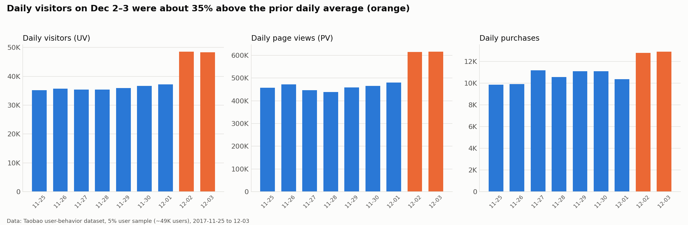
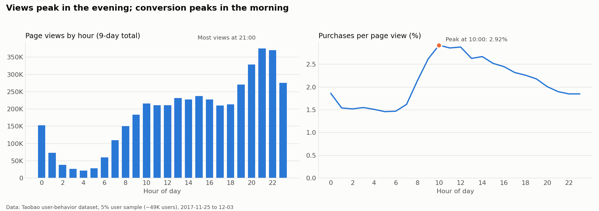
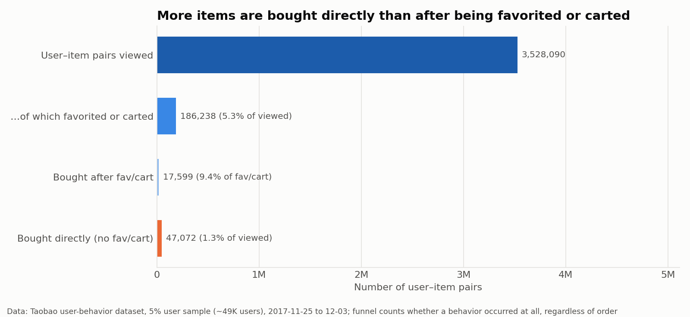
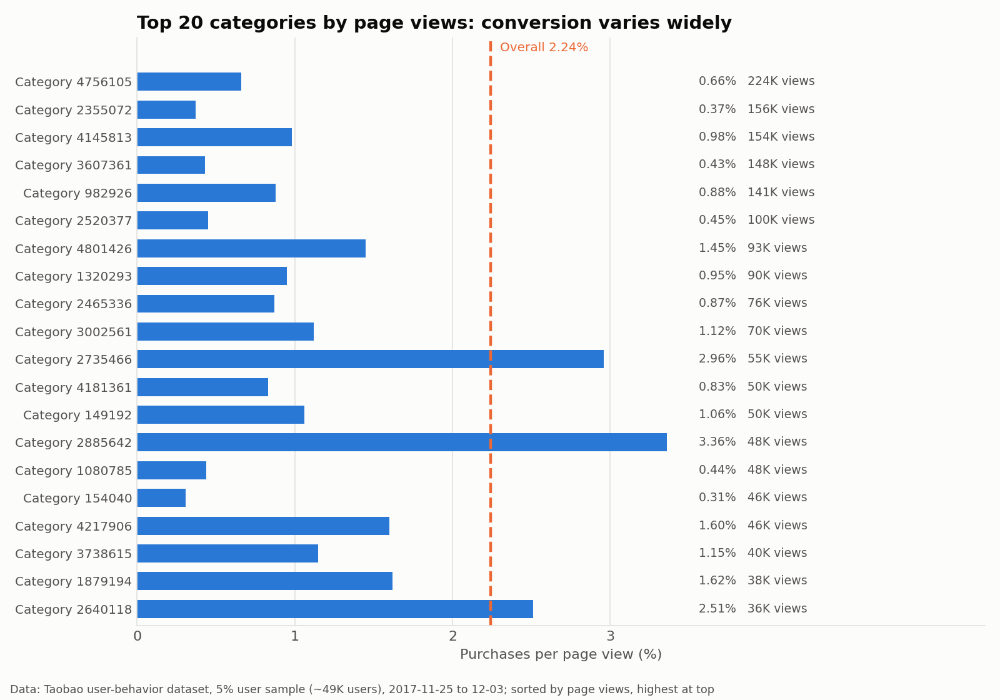
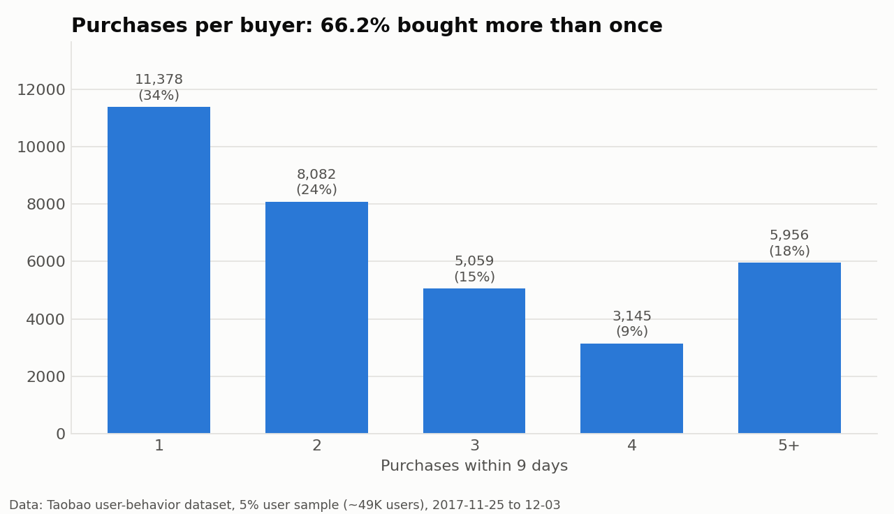
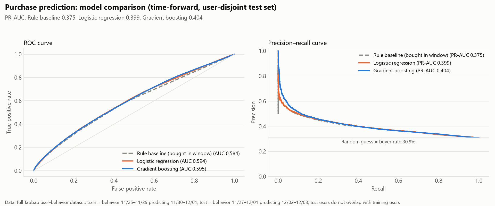
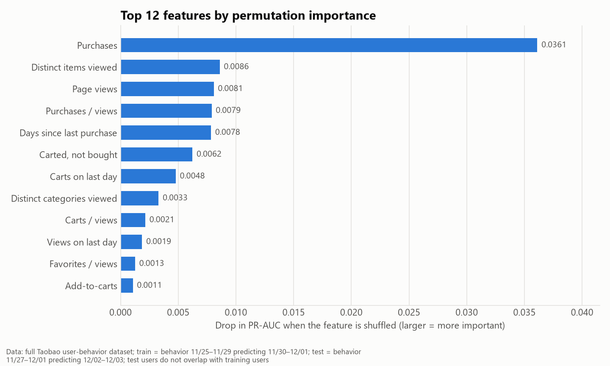
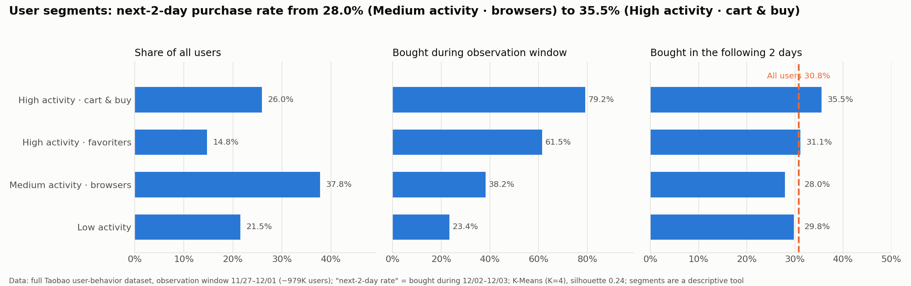

**English** | [简体中文](README.zh-CN.md)

# Taobao User Behavior Analysis: MySQL + PySpark + scikit-learn

An end-to-end analysis of the public Taobao user-behavior dataset from Alibaba Tianchi (about 100 million records over 9 days): data cleaning, SQL business analysis, full-scale feature engineering, purchase prediction and user segmentation. The goal is not a high model score, but to be explicit about definitions, baselines and limitations at every step.

## What this project does

- Cleans and loads the data in MySQL and answers 6 groups of business questions (overview metrics, time trends, conversion funnel, categories, cart abandonment, repeat purchase).
- Builds user-level features with PySpark on the full 100M rows, using time-forward train/test snapshots.
- Predicts purchase with scikit-learn (including a rule-based baseline) and segments users with K-Means.
- Every SQL query was run on both MySQL and DuckDB (5% sample) with matching results; Spark features were checked against an independent DuckDB recomputation on the 5% sample, with no per-user mismatches.

## Data

- Source: Alibaba Tianchi, *User Behavior Data from Taobao for Recommendation*. This repository **does not contain the raw data**; download it from Tianchi (mind its terms of use).
- Size: 100,150,807 rows; fields are user ID, item ID, category ID, behavior type and timestamp. Behavior types: pv (page view), fav (favorite), cart (add to cart), buy (purchase).
- Time range: 2017-11-25 to 2017-12-03, 9 days (Beijing time). About 56K rows (~0.06%) fall outside this range and are dropped during cleaning.
- There is no price, user profile or item attribute, so the analysis is limited to behavior.
- The data is described as a random user sample, but about 48-49% of users made a purchase in the window, which is high. Be careful when generalizing to the whole platform.

## Pipeline

| Step | Tool | Notes |
|---|---|---|
| Sampling | awk / Python | 5% of users (1 in 20), keeping each user's trajectory complete |
| Load, clean, business analysis | MySQL 9.7 | `sql/00`-`09`, run in numeric order |
| Cross-check | DuckDB | Same SQL re-run on DuckDB; results match |
| Feature engineering | PySpark 4.2 | Full data, ~1.96M user-level rows |
| Modeling and segmentation | scikit-learn | Logistic regression, gradient boosting, K-Means |
| Visualization | pandas / matplotlib | Charts are generated directly from SQL results |

## 1. Business analysis (5% user sample: 49,396 users, ~4.97M records)

> 68% of users in the sample bought within the 9 days, higher than typical e-commerce. All ratios below describe this dataset only, not the platform as a whole.

On average a user has 90 page views; purchases per page view is 2.24%.



On Dec 2-3 the number of active users is about 35% above the earlier daily average, with page views and purchases rising together. The data gives no direct evidence on whether promotions caused this, so no conclusion is drawn.



Page views peak around 9 pm, while purchases per page view peak at 10 am (2.92%) and sit near 1.5% between 1 and 6 am.



By user-item pair: 3,528,090 pairs were viewed; 186,238 (5.3%) were also favorited or carted; 17,599 of those were bought (9.4% of favorited/carted pairs). 47,072 pairs were bought without any favorite/cart (1.3% of viewed pairs). The funnel records whether a behavior occurred, not its order.



There are 7,498 categories; the top 10 account for 13.2% of purchases and the top 100 for 44.3%. Among the 20 most-viewed categories, purchases per page view range from 0.31% to 3.36%.



Among buyers, 66.2% bought more than once in 9 days. 93.6% of carted items were not bought within the window; the window is short and later purchases are not visible, so this figure is inflated.

## 2. Purchase prediction (full data)

**Task**: given a user's behavior over 5 days, predict whether they buy at least once in the following 2 days.

**Evaluation design**

- Time-forward: train on behavior 11/25-11/29 predicting 11/30-12/01; test on behavior 11/27-12/01 predicting 12/02-12/03. Both snapshots use the same window lengths, and test labels come after train labels.
- User-disjoint: users are hashed by ID; ~70% train, 10% for threshold selection, 20% used only for testing.
- 17 features: counts per behavior, active days, distinct items/categories, last-day behavior, days since last activity/purchase, items carted or favorited but not bought, behavior ratios.
- Comparisons: rule baseline (bought during the observation window -> predict they buy again), logistic regression, gradient boosting (sklearn HistGradientBoosting with early stopping, no hyperparameter search).

**Results** (test set: 195,623 users, purchase rate 30.9%; PR-AUC of random guessing is about 0.309)

| Model | ROC-AUC | PR-AUC | Precision | Recall | F1 |
|---|---|---|---|---|---|
| Rule baseline | 0.584 | 0.375 | 0.367 | 0.586 | 0.451 |
| Logistic regression | 0.594 | 0.399 | 0.352 | 0.694 | 0.467 |
| Gradient boosting | 0.595 | 0.404 | 0.346 | 0.737 | 0.471 |

Precision, recall and F1 use the threshold that maximizes F1 on the validation set (the rule baseline uses "bought in the observation window").





Purchases count ranks highest by permutation importance, followed by distinct items viewed, page views, purchase/view ratio and days since last purchase. Importance reflects how much the model relies on a feature, not causality.

**How to read it: the models help, but only slightly**

Both learned models improve only modestly over the rule baseline (PR-AUC about +0.03, F1 about +0.02). To understand why, I ran a diagnosis with a smaller gradient boosting model (250K training samples, 100 iterations):

| Evaluated on | Purchase rate | ROC-AUC | PR-AUC |
|---|---|---|---|
| Training set itself | 25.4% | 0.641 | 0.398 |
| New users, same period (validation) | 25.8% | 0.631 | 0.379 |
| New users, later period (test) | 30.9% | 0.593 | 0.402 |
| Same users, later period | 30.8% | 0.591 | 0.400 |

- Training and same-period new-user AUC are close (0.641 vs 0.631), so there is no clear overfitting; new users and same users give almost identical results on the test period (0.593 vs 0.591), so the user split does not leak.
- Even on same-period new users AUC is only about 0.63, meaning these 17 aggregated behavior features carry limited information.
- In the test window, the purchase rate of users who had not bought in the observation window rises from 19.7% to 25.3%. The overall level shifts up and discrimination drops by about 0.04 AUC. This is an inference from the data and was not tested with a controlled experiment.

## 3. User segmentation

K-Means (K=4) on the observation window of the test snapshot (11/27-12/01, ~980K users). The silhouette score is about 0.24: user behavior is a continuum without natural clusters, so segmentation is used as a descriptive tool and K=4 was chosen for interpretability.



| Segment | Share | Median views | Median carts | Median favorites | Median purchases | Bought in window | Bought in next 2 days |
|---|---|---|---|---|---|---|---|
| Low activity | 21.5% | 6 | 0 | 0 | 0 | 23.4% | 29.8% |
| Medium activity, browsers | 37.8% | 25 | 1 | 0 | 0 | 38.2% | 28.0% |
| High activity, favoriters | 14.8% | 68 | 1 | 6 | 1 | 61.5% | 31.1% |
| High activity, cart & buy | 26.0% | 70 | 6 | 0 | 2 | 79.2% | 35.5% |

Next-2-day purchase rates differ by only about 7 percentage points across segments, consistent with the limited signal found in the prediction section. Full profile: `models/segment_profile.en.csv`. Numbers come from a single K-Means run and may shift slightly with a different sklearn version.

## 4. Engineering notes

- MySQL's default InnoDB buffer pool is only 128 MB; single aggregate queries on a 5M-row table took 4-28 minutes. After raising it to 8 GB, similar queries ran in seconds.
- The full 100M rows are not practical to analyze in MySQL, so MySQL handles the 5% sample and PySpark handles full-scale feature engineering.
- Writing files from Spark on Windows needs extra Hadoop components, so Spark only aggregates and results are saved with pandas.
- Validation: SQL results match between MySQL and DuckDB; on the 5% sample, 11 Spark features plus the label match an independent DuckDB recomputation per user (no per-user check on the full data).

## 5. Limitations and next steps

- No price, user or item attributes: only behavioral features; the prediction window is 2 days and the data spans only 9 days.
- The test window (12/02-12/03) happens to be a traffic surge, so there is distribution shift and results do not represent normal periods.
- Prediction is user-level ("will the user buy"), not user-item level, which would be closer to cart-recall use cases.
- No hyperparameter search and no richer time-series features (daily sequences, last-hours behavior, category preference).
- The data is biased toward active/buying users; do not extrapolate to the whole platform.

## Reproduce

1. Download `UserBehavior.csv` from Tianchi and place it in the project root (not committed).
2. Sample: `python scripts/make_sample.py UserBehavior.csv data/sample_5pct.csv 20`
3. In MySQL run `sql/00`-`03` (schema, load, clean, indexes), then `sql/04`-`09` (needs `local_infile`; raise `innodb_buffer_pool_size`).
4. `pip install -r requirements.txt`, then `python scripts/make_figures.py --lang en` for business charts (reads MySQL; drop `--lang en` for Chinese).
5. Feature engineering (JDK 17/21 required): `python spark/01_build_features.py`
6. Modeling and segmentation: `python scripts/train_models.py --lang en` and `python scripts/cluster_users.py --lang en`

## Layout

```
sql/         MySQL schema, load, clean and analysis scripts
spark/       PySpark feature engineering
scripts/     sampling, plotting, modeling, segmentation (--lang zh|en)
figures/     Chinese charts (figures/en/ holds the English ones)
models/      metrics and segment profiles
docs/        presentation notes (English and Chinese)
```

Code comments are mostly in Chinese; SQL and main script headers carry an English line.
